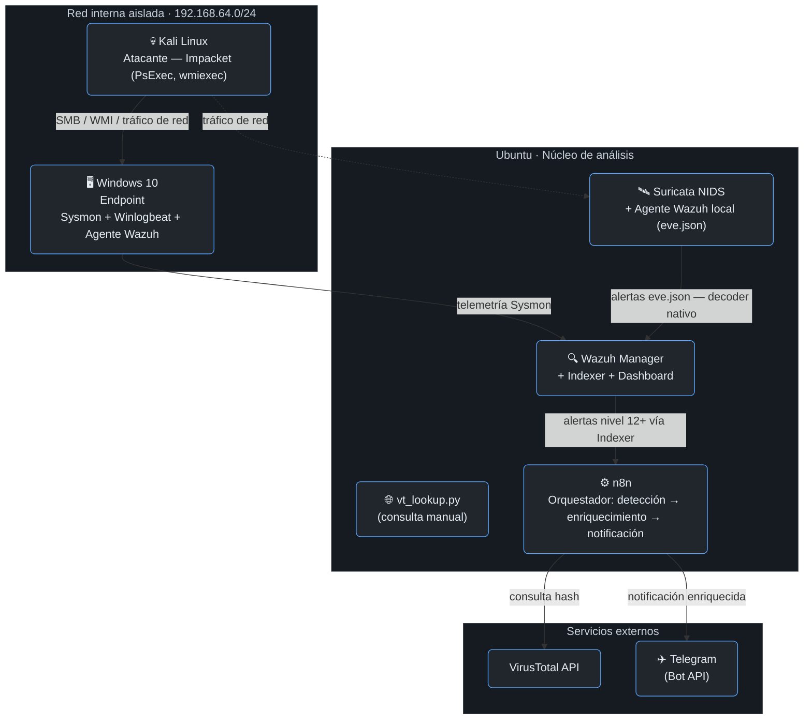
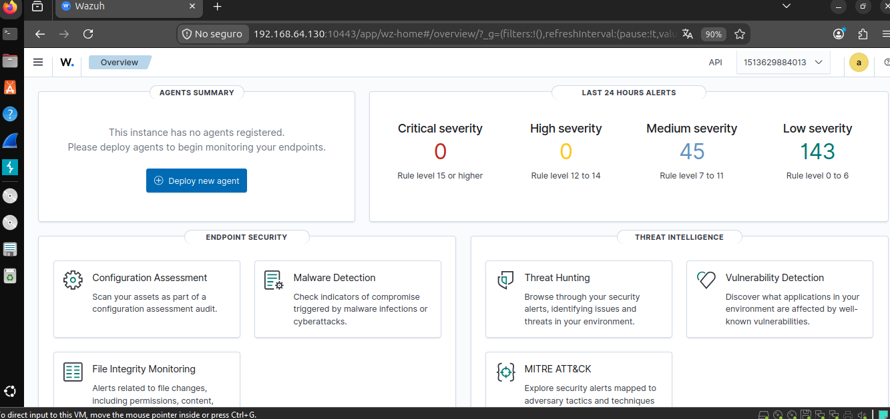

# 🛡️ Threat Hunting & Detection Lab

[](https://img.shields.io/badge/Status-Completed-brightgreen) [](https://img.shields.io/badge/Platform-Windows%2010-blue) [](https://img.shields.io/badge/SIEM-Wazuh%204.14.7-purple) [](https://img.shields.io/badge/Telemetry-Sysmon-blue) [](https://img.shields.io/badge/NIDS-Suricata-orange) [](https://img.shields.io/badge/Orchestration-n8n-red) [](https://img.shields.io/badge/Notification-Telegram-26A5E4) [](https://img.shields.io/badge/Threat%20Intel-VirusTotal-blue) [](https://img.shields.io/badge/Persistence-SQLite-lightgrey) [](https://img.shields.io/badge/MITRE%20ATT%26CK-12%20Techniques%20Mapped-red)

**Threat hunting proactivo, ingeniería de detección, simulación de movimiento lateral y orquestación de respuesta — sobre un entorno corporativo simulado con Windows, Kali Linux y Wazuh**

**Estado:** Fase host-based + Suricata + Kali + VirusTotal + orquestación con n8n + notificación por Telegram + persistencia en SQLite + cadena de Credential Access (BITSAdmin/LSASS/Mimikatz) completa · **Wazuh:** 4.14.7 · **Framework:** MITRE ATT&CK
**Última actualización (Nov 2026):** reglas de detección validadas contra tráfico real, NIDS endurecido y pipeline de notificación con Telegram — ver [`docs/VALIDACION-REGLAS-SURICATA.md`](docs/VALIDACION-REGLAS-SURICATA.md) y [`docs/PIPELINE-AUTOMATIZACION.md`](docs/PIPELINE-AUTOMATIZACION.md).

---

📖 **[Guía de instalación paso a paso](docs/INSTALACION.md)** — cómo levantar el lab completo desde cero.

## 📋 Resumen ejecutivo

Este proyecto simula un entorno corporativo donde un endpoint Windows es atacado usando técnicas reales de *Living-off-the-Land* (LOLBins) y **movimiento lateral con un atacante externo real** (Kali Linux), correlacionadas a nivel de host (Sysmon + Wazuh), de red (Suricata NIDS), enriquecidas con reputación de archivos (VirusTotal) y orquestadas de punta a punta con **n8n**, que automatiza la detección, el enriquecimiento y la notificación sin intervención manual.

El objetivo no es solo detectar — es **documentar el razonamiento de análisis**: qué se detectó, por qué, qué fue ruido, qué falló y por qué, y cómo se ajustó la detección con criterio profesional.

---

## 🏗️ Arquitectura




*Dashboard de Wazuh tras el despliegue inicial del stack.*

---

## 🧰 Stack tecnológico

| Componente | Herramienta | Rol |
|---|---|---|
| Generación de telemetría | Sysmon (config SwiftOnSecurity/Olaf Hartong) + Winlogbeat | Captura de eventos a nivel de host |
| SIEM / Correlación | Wazuh 4.14.7 (Docker) | Ingesta, reglas de detección, MITRE ATT&CK mapping |
| Simulación de ataques (host) | Atomic Red Team | Ejecución controlada y reproducible de técnicas ATT&CK |
| Simulación de ataques (red) | Kali Linux + Impacket | Movimiento lateral real (PsExec, WMI) desde un atacante externo |
| Detección de red | Suricata (NIDS nativo en Ubuntu, systemd) | Detección de patrones de red — User-Agent, IOCs de descarga, canales encubiertos |
| Threat Intelligence | VirusTotal API v3 | Reputación de archivos por hash — consulta manual (script) y automática (workflow n8n) |
| Orquestación | n8n (Docker) | Pipeline automático: detección → deduplicación → enriquecimiento → notificación |
| Persistencia | SQLite | Deduplicación e historial de alertas enriquecidas, consultable con SQL |
| Notificación | Telegram (Bot API) | Alerta enriquecida y formateada (MarkdownV2) enviada a un bot personal en tiempo real |

---

## 🎯 Cobertura MITRE ATT&CK

### Fase Host-Based (Atomic Red Team)

| Técnica | ID | Estado | Detección |
|---|---|---|---|
| PowerShell EncodedCommand | T1059.001 | ✅ Completo | Nativa (92071) + custom (100020) + Suricata (User-Agent) |
| CertUtil (masquerading + decode) | T1140 | ✅ Completo | Nativa (92016 + 92017) |
| Rundll32 proxy execution | T1218.011 | ✅ Completo | Custom (100030) |
| Regsvr32 (Squiblydoo) | T1218.010 | ✅ Completo | Custom (100040) + Suricata (.sct) |
| Scheduled Task persistence | T1053.005 | ✅ Completo | Custom (100050) |
| DLL Side-Loading (masquerading) | T1574.001¹ | ✅ Completo | Custom (100060) |
| Mshta | T1218.005 | ⚠️ Telemetría parcial² | — |

¹ *T1574.002 no tiene atomic público disponible; se sustituyó por T1574.001 (mismo mecanismo de fondo).*
² *Ver [Lecciones aprendidas](docs/LECCIONES-APRENDIDAS.md) — bug documentado del agente de Wazuh.*

### Fase Movimiento Lateral (Kali + Impacket)

| Técnica | ID | Estado | Detección |
|---|---|---|---|
| PsExec (SMB/ADMIN$) | T1569.002 | ✅ Completo | Nativa (92218) — AV bloqueó el binario antes de ejecutar |
| WMI remoto | T1047 | ✅ Completo | Custom (100070) — sin cobertura nativa, técnica sigilosa (AV no la detectó) |

### Fase Credential Access & Persistencia adicional (Atomic Red Team)

| Técnica | ID | Estado | Detección |
|---|---|---|---|
| BITSAdmin (transferencia de archivos vía BITS) | T1197 | ✅ Completo | Custom (100090) — sin cobertura nativa específica |
| LSASS Memory Access | T1003.001 | ⚠️ Prevención confirmada³ | Custom (100100) — diseñada, no validada con telemetría real |
| Mimikatz Indicators | T1003 | ⚠️ Prevención confirmada³ | Custom (100110) — diseñada, no validada con telemetría real |

³ *Windows Defender bloqueó la ejecución antes de que Sysmon generara el evento de creación de proceso — ver [Casos de detección: BITSAdmin, LSASS y Mimikatz](docs/CASOS-DE-DETECCION.md#-casos-de-detección--bitsadmin-lsass-y-mimikatz).*

---

## 📁 Estructura del repositorio

```
Threat-Hunting-Detection-Lab/
├── README.md
├── docs/
│   ├── INSTALACION.md                  ← guía paso a paso para levantar el lab completo
│   ├── CASOS-DE-DETECCION.md           ← detalle técnico de cada técnica MITRE ATT&CK
│   ├── VALIDACION-REGLAS-SURICATA.md   ← validación de reglas Wazuh + hardening de Suricata
│   ├── PIPELINE-AUTOMATIZACION.md      ← VirusTotal + n8n + SQLite + Telegram
│   ├── LECCIONES-APRENDIDAS.md         ← hallazgos técnicos y de criterio de análisis
│   └── screenshots/
├── detections/
│   ├── sysmon-rules/
│   │   └── local_rules.xml             ← todas las reglas custom de Wazuh/Sysmon, consolidadas (12 reglas validadas)
│   ├── virustotal-enrichment/
│   │   ├── vt_lookup.py                ← consulta manual de un hash
│   │   └── wazuh_vt_enrich.py          ← script original — prototipo del workflow de n8n
│   ├── T1059.001-powershell-encoded/
│   ├── T1140-certutil-masquerade/
│   ├── T1218.011-rundll32/
│   ├── T1218.010-regsvr32-squiblydoo/
│   ├── T1053.005-scheduled-tasks/
│   ├── T1574.001-dll-sideloading/
│   ├── T1218.005-mshta-partial/
│   ├── T1569.002-psexec/
│   ├── T1047-wmi-lateral-movement/
│   ├── T1197-bitsadmin/
│   ├── T1003.001-lsass-access/
│   ├── T1003-mimikatz/
│   └── suricata-nids/
│       └── local.rules                 ← reglas custom de Suricata (5 reglas, validadas con tráfico real)
└── n8n-workflows/
    ├── soc-n8n-workflow.json            ← export del workflow de orquestación (sanitizado: sin tokens/credenciales)
    ├── README-reproducir-pipeline.md    ← cómo reimportar el workflow y recrear credenciales/DB
    └── db/
        ├── schema.sql                  ← estructura de la tabla SQLite (sin el binario)
        └── sample_export.csv           ← muestra real de alertas procesadas
```

---

---

## 📂 Documentación detallada

El razonamiento completo de cada etapa del proyecto — qué se probó, qué falló, cómo se corrigió — vive en archivos separados para no sobrecargar este README:

| Documento | Contenido |
|---|---|
| [`docs/INSTALACION.md`](docs/INSTALACION.md) | Guía paso a paso para levantar el lab completo desde cero (3 VMs, Wazuh, Sysmon, Suricata, n8n) |
| [`docs/CASOS-DE-DETECCION.md`](docs/CASOS-DE-DETECCION.md) | Detalle técnico de cada técnica MITRE ATT&CK: qué detectó cada capa y por qué |
| [`docs/VALIDACION-REGLAS-SURICATA.md`](docs/VALIDACION-REGLAS-SURICATA.md) | Metodología de validación de las 12 reglas de Wazuh y hardening de Suricata |
| [`docs/PIPELINE-AUTOMATIZACION.md`](docs/PIPELINE-AUTOMATIZACION.md) | De script manual a pipeline n8n: VirusTotal, SQLite y notificación por Telegram |
| [`docs/LECCIONES-APRENDIDAS.md`](docs/LECCIONES-APRENDIDAS.md) | Hallazgos técnicos y de criterio de análisis a lo largo de todo el proyecto |
| [`n8n-workflows/README-reproducir-pipeline.md`](n8n-workflows/README-reproducir-pipeline.md) | Cómo reimportar el workflow de n8n y recrear credenciales/base de datos |

---

## 🧪 Cómo usar este lab

Todo el código de detección (reglas de Wazuh y Suricata) y el workflow de n8n está pensado para que otra persona pueda reproducir el lab o reutilizar piezas sueltas.

```bash
git clone https://github.com/braianffernandez096-bripto/Threat-Hunting-Detection-Lab.git
cd Threat-Hunting-Detection-Lab
```

- **¿Querés levantar el lab completo** (3 VMs, Wazuh, Sysmon, Suricata, n8n)? Seguí [`docs/INSTALACION.md`](docs/INSTALACION.md) de punta a punta.
- **¿Solo te interesan las reglas de detección?** Están listas para copiar en `detections/sysmon-rules/local_rules.xml` (Wazuh) y `detections/suricata-nids/local.rules` (Suricata) — o por técnica individual en `detections/T*/`.
- **¿Querés el pipeline de alertas por Telegram?** Importá `n8n-workflows/soc-n8n-workflow.json` en tu instancia de n8n y seguí [`n8n-workflows/README-reproducir-pipeline.md`](n8n-workflows/README-reproducir-pipeline.md) para recrear credenciales, bot de Telegram y base SQLite (el export está sanitizado, sin tokens ni IDs reales).

No se requiere ninguna credencial propia del autor: cada integración (VirusTotal, Telegram, Wazuh) se configura con tus propias claves siguiendo las guías de instalación.

---

## 🗺️ Roadmap

- [x] Completar las 6 técnicas LOLBin host-based
- [x] Configurar Kali Linux como atacante y simular movimiento lateral (PsExec, WMI)
- [x] Implementar enriquecimiento con VirusTotal (script standalone, prototipo para n8n)
- [x] Instalar n8n y portar la lógica de `wazuh_vt_enrich.py` a un workflow visual con deduplicación y notificación automática
- [x] Migrar la deduplicación de static data a SQLite, con historial completo de alertas enriquecidas consultable por SQL
- [x] Sumar cadena de Credential Access/Persistence: BITSAdmin (T1197), LSASS Memory Access (T1003.001) y Mimikatz Indicators (T1003)
- [x] Validar las 12 reglas custom de Wazuh/Sysmon contra telemetría real, corrigiendo 2 reglas rotas (100030, 100090)
- [x] Instalar y validar Suricata (NIDS) con 5 reglas validadas contra tráfico real y persistencia vía systemd
- [x] Integrar Suricata con Wazuh vía agente nativo (eve.json → decoder nativo de Suricata)
- [x] Reconstruir el pipeline de n8n con notificación por Telegram (mensajes MarkdownV2 resistentes a caracteres especiales)

---

## 👤 **Braian Fernandez**
Analista SOC en formación
[GitHub](https://github.com/braianffernandez096-bripto) · [LinkedIn](https://www.linkedin.com/in/braian-fernandez96)
