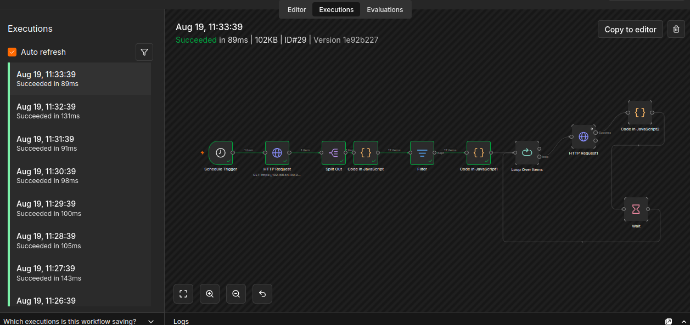
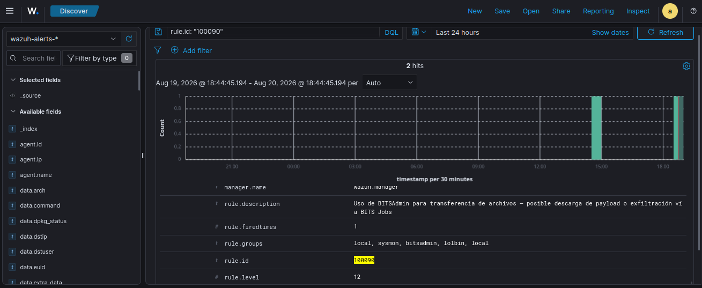
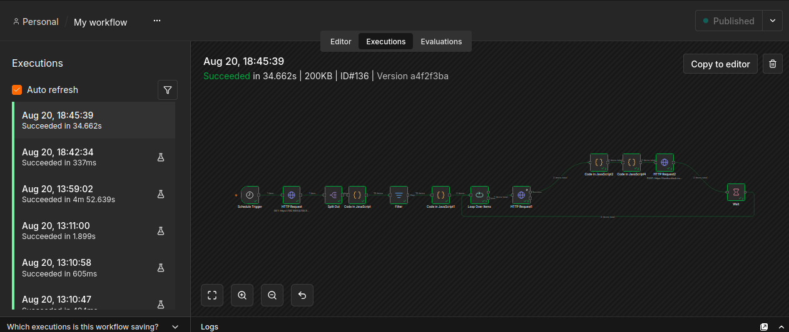
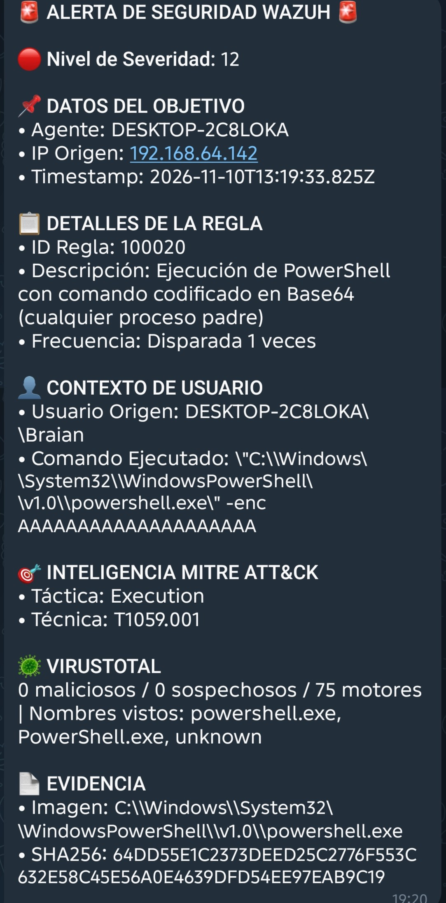

# Pipeline de automatización — VirusTotal, n8n, SQLite y Telegram

Cómo pasó de un script manual de enriquecimiento a un pipeline automático de detección → enriquecimiento → notificación, con persistencia en SQLite y alertas vía Telegram. Volver al [README principal](../README.md).

---

## 🌐 Enriquecimiento con VirusTotal

Implementado como **scripts standalone en Python** en Ubuntu (`~/soc-l2-scripts`), diseñados como prototipo: la misma lógica de consulta se porta después a un nodo de n8n sin reescribir nada.

### `vt_lookup.py` — consulta manual de un hash

```
export VT_API_KEY="tu-api-key"
python3 vt_lookup.py <hash>
```

Validado con dos hashes reales de la sesión — `GUP.exe` y `schtasks.exe`, ambos limpios (0 detecciones en 74-75 motores), como corresponde a binarios legítimos. En ambos casos, VirusTotal reveló **nombres alternativos sospechosos** con los que esos mismos binarios circulan en el mundo real (`XClien1488t.bat.exe`, `Jh.exe`) — evidencia de que el patrón de masquerading que estudiamos hoy también ocurre en campañas reales.

### `wazuh_vt_enrich.py` — enriquecimiento automático

Consulta el Indexer de Wazuh (OpenSearch) por alertas de **nivel 12+** con hash asociado, extrae el SHA256, y lo enriquece vía la API de VirusTotal, con deduplicación local (`.vt_procesados.json`) y respeto del rate limit del tier gratuito (4 req/min).

Corrida completa sobre toda la sesión: **17 alertas procesadas, todas limpias** — y de paso reveló dos hallazgos no documentados hasta ese momento (ver más abajo).


---

## ⚙️ Orquestación con n8n — de script manual a pipeline automático

El script `wazuh_vt_enrich.py` funcionaba, pero requería ejecución manual, no tenía forma de notificar al equipo, y su lógica quedaba encerrada en código. El siguiente paso fue migrar esa misma lógica a un **workflow visual en n8n** (corriendo en Docker sobre la misma VM Ubuntu), agregando lo que un script standalone no resuelve por sí solo: ejecución automática recurrente, deduplicación persistente entre corridas, y notificación al equipo.

### El pipeline, nodo por nodo

| # | Nodo | Función |
|---|------|---------|
| 1 | **Schedule Trigger** | Dispara el workflow cada 5 minutos |
| 2 | **HTTP Request** (Indexer) | Consulta a Wazuh (OpenSearch) por alertas `rule.level >= 12` con hash de archivo asociado |
| 3 | **Split Out** | Separa el array de alertas en items individuales de n8n |
| 4 | **Code** (extracción) | Extrae el SHA256 vía regex y estructura los campos clave de cada alerta (regla, MITRE, imagen, comando) |
| 5 | **Filter** | Descarta alertas sin hash válido |
| 6 | **Code** (deduplicación) | Filtra alertas ya procesadas en corridas anteriores, usando el *static data* de n8n |
| 7 | **Loop Over Items** | Procesa las alertas de a una (batch size 1) |
| 8 | **HTTP Request** (VirusTotal) | Consulta la reputación del hash contra la API v3 de VT |
| 9 | **Code** (registro) | Marca la alerta como procesada en el static data |
| 10 | **Code** (formateo) | Arma el mensaje final con el resumen de VT (maliciosos/sospechosos/motores) |
| 11 | **HTTP Request** (Telegram) | Envía la notificación al bot vía Bot API |
| 12 | **Wait (16s)** | Respeta el rate limit del tier gratuito de VT (4 req/min), y vuelve a alimentar el loop |

### Decisiones técnicas y desafíos resueltos

**Puerto del Indexer vs. Dashboard.** El primer intento de conexión devolvió un `404 Not Found` en vez de un error de conexión — señal de que el servidor respondía, pero no en la ruta esperada. Investigando los contenedores Docker (`docker ps`), se confirmó que el puerto expuesto inicialmente (10443) correspondía al **Wazuh Dashboard** (mapeado desde el puerto 5601 interno), no al **Indexer** — que corre en el 9200. Un buen recordatorio de que un código de error específico (404 vs. timeout) acota mucho más rápido el diagnóstico que "no conecta".

**Rate limiting fiel al script original.** El mismo `time.sleep(16)` del script se replicó con un patrón **Loop Over Items (batch size 1) → HTTP Request → Wait (16s) → vuelve al loop**, procesando un hash a la vez con la misma cadencia que respetaba el tier gratuito de VT.

**Deduplicación sin base de datos externa.** El script original usaba un archivo `.vt_procesados.json` local para no re-consultar hashes ya vistos. En n8n, el equivalente es el **static data del workflow** (`$getWorkflowStaticData('global')`), un storage persistente atado al propio workflow. Un detalle no documentado descubierto en el camino: el static data **solo persiste en ejecuciones de producción** (disparadas por el trigger real, con el workflow *publicado y activo*) — las ejecuciones manuales de prueba en el editor no lo graban, aunque el workflow esté guardado.

**Manejo de "sin registro en VirusTotal".** Un hash no encontrado en VT (archivo nunca antes visto) responde con `404`. En vez de dejar que esto corte el workflow, el nodo HTTP Request se configuró con **"Continue (using error output)"**, separando la respuesta en dos ramas (éxito / error) para tratar cada caso explícitamente — igual que el `try/except` del script original.

### Resultado en producción

- **Deduplicación validada**: la primera corrida procesó las 17 alertas de la sesión (≈4m 43s, respetando el rate limit); las corridas siguientes, sin alertas nuevas, terminan en ~100ms sin consultar VT ni consumir cuota.
- **Notificación validada**: las 17 alertas enriquecidas llegaron correctamente al bot de Telegram configurado, con el resumen de VirusTotal, regla, técnica MITRE, imagen y hash de cada una.



### Demo en vivo: el pipeline completo reaccionando a una alerta nueva

Para verificar que el pipeline funciona como orquestador real (y no solo en la corrida inicial de las 17 alertas), se corrió de nuevo el Atomic Test de BITSAdmin con el Schedule Trigger activo, sin intervención manual — capturando las 4 etapas del ciclo:

1. **Wazuh genera la alerta nueva** (`rule.id: 100090`, nivel 12) al ejecutarse el test en la VM Windows.
2. **n8n la recoge en su próximo ciclo** (máx. 5 min después) y corre el pipeline completo — la ejecución tardó **34.6 segundos** (vs. los ~100-600ms de los ciclos vacíos cuando no hay alertas nuevas), señal clara de que esta vez sí procesó una alerta real, consultando VirusTotal.
3. **SQLite registra la alerta** con su resultado de VT y timestamp.
4. **Telegram recibe la notificación** con el resumen enriquecido.




**Un detalle relevante sobre la deduplicación**: correr el mismo Atomic Test dos veces genera dos `alerta_id` distintos en Wazuh (aunque el hash del archivo sea idéntico) — la deduplicación de n8n opera sobre el **evento individual**, no sobre "la técnica ya fue vista antes". Esto es intencional y correcto: cada ejecución de un ataque es un evento nuevo que merece su propia notificación, aunque el análisis de reputación del archivo (VirusTotal) dé el mismo resultado que la vez anterior.

### Comparación con la versión en Python

| | Script (`wazuh_vt_enrich.py`) | Workflow en n8n |
|---|---|---|
| Ejecución | Manual (`python3 wazuh_vt_enrich.py`) | Automática, cada 5 minutos |
| Deduplicación | Archivo `.vt_procesados.json` → migrado a SQLite | Static data → migrado a SQLite |
| Rate limiting | `time.sleep(16)` | Loop + nodo Wait |
| Salida | `print()` en consola | Notificación en Telegram |
| Mantenimiento | Requiere editar código Python | Editable visualmente, sin tocar código en la mayoría de los cambios |


---

## 🗄️ Migración a SQLite — deduplicación e historial persistente

El static data de n8n cumplía su función, pero es una solución de laboratorio: no es consultable con SQL, no sirve como historial, y (como se documenta más abajo) solo persiste en ejecuciones de producción, no en pruebas manuales. El siguiente paso fue reemplazarlo por una base de datos **SQLite** real — liviana, sin overhead de un servidor de base de datos corriendo en background, ideal para el volumen de este proyecto y para los recursos disponibles en la VM del lab (12 GB RAM / 4 núcleos).

Esta misma tabla cumple una doble función: **deduplicación** (no volver a consultar un hash ya procesado) e **historial completo consultable** de alertas enriquecidas — resolviendo de paso el pendiente de sumar un registro histórico, sin necesitar una herramienta externa como Google Sheets.

### Esquema de la base

```sql
CREATE TABLE alertas (
  alerta_id TEXT PRIMARY KEY,
  regla_id TEXT,
  nivel INTEGER,
  descripcion TEXT,
  mitre_id TEXT,
  imagen TEXT,
  sha256 TEXT,
  vt_maliciosos INTEGER,
  vt_sospechosos INTEGER,
  vt_total_motores INTEGER,
  vt_estado TEXT,
  fecha_procesado TEXT DEFAULT CURRENT_TIMESTAMP
);
```

### Cómo se integró con n8n

n8n no tiene un nodo nativo para SQLite (a diferencia de Postgres/MySQL), así que se manejó desde nodos **Code**, usando el módulo `sqlite3` de Node.js. Esto implicó resolver dos problemas de infraestructura antes de tocar la lógica:

**1. El contenedor de n8n no veía el archivo de la base.** n8n corre en Docker, con un único bind mount (`/home/brian/n8n-data` → `/home/node/.n8n`). La base de datos se ubicó directamente dentro de esa carpeta ya montada (`~/n8n-data/db/soc_alerts.db`), evitando tener que agregar un volumen nuevo y recrear el contenedor por ese motivo.

**2. n8n bloquea `require()` de módulos externos por seguridad.** Para permitir `sqlite3` dentro de los nodos Code, hizo falta:
- Instalar el módulo en una carpeta propia dentro del contenedor (no en el `package.json` interno de n8n, que usa el protocolo de workspaces `pnpm` y rechaza un `npm install` normal):
  ```bash
  docker exec -u root -it n8n mkdir -p /home/node/.n8n/custom-modules
  docker exec -u root -it n8n npm install sqlite3 --prefix /home/node/.n8n/custom-modules
  ```
- Recrear el contenedor (parar, eliminar y levantar de nuevo — sin pérdida de datos, ya que workflows y credenciales viven en el volumen montado) sumando dos variables de entorno: `NODE_PATH` apuntando a la carpeta del módulo, y `NODE_FUNCTION_ALLOW_EXTERNAL=sqlite3` para habilitar explícitamente su uso:
  ```bash
  docker run -d \
    --name n8n \
    -p 5678:5678 \
    -v /home/brian/n8n-data:/home/node/.n8n \
    -e N8N_BASIC_AUTH_ACTIVE=true \
    -e N8N_BASIC_AUTH_USER=admin \
    -e N8N_BASIC_AUTH_PASSWORD=************ \
    -e NODE_PATH=/usr/local/lib/node_modules:/home/node/.n8n/custom-modules/node_modules \
    -e NODE_FUNCTION_ALLOW_EXTERNAL=sqlite3 \
    docker.n8n.io/n8nio/n8n
  ```

### Los dos nodos reescritos

**Deduplicación** (reemplaza el chequeo contra static data — Mode: *Run Once for All Items*):

```javascript
const sqlite3 = require('sqlite3').verbose();
const path = '/home/node/.n8n/db/soc_alerts.db';

return new Promise((resolve, reject) => {
  const db = new sqlite3.Database(path, sqlite3.OPEN_READWRITE, (err) => {
    if (err) { reject(new Error('Error abriendo DB: ' + err.message)); return; }
    db.all('SELECT alerta_id FROM alertas', [], (err, rows) => {
      db.close();
      if (err) { reject(new Error('Error consultando: ' + err.message)); return; }
      const procesados = new Set(rows.map(r => r.alerta_id));
      const items = $input.all();
      const nuevos = items.filter(item => !procesados.has(item.json.alerta_id));
      resolve(nuevos);
    });
  });
});
```

**Registro e historial** (reemplaza el marcado en static data, ahora guarda también el resultado completo de VT — Mode: *Run Once for Each Item*):

```javascript
const sqlite3 = require('sqlite3').verbose();
const path = '/home/node/.n8n/db/soc_alerts.db';

const vtData = $json.data;
const alertaOriginal = $('Code in JavaScript').item.json;

let vtEstado, vtMaliciosos, vtSospechosos, vtTotalMotores;
if (!vtData) {
  vtEstado = 'sin_registro';
  vtMaliciosos = vtSospechosos = vtTotalMotores = null;
} else {
  const stats = vtData.attributes?.last_analysis_stats || {};
  vtEstado = 'ok';
  vtMaliciosos = stats.malicious ?? 0;
  vtSospechosos = stats.suspicious ?? 0;
  vtTotalMotores = Object.values(stats).reduce((a, b) => a + b, 0);
}

return new Promise((resolve, reject) => {
  const db = new sqlite3.Database(path, sqlite3.OPEN_READWRITE, (err) => {
    if (err) { reject(new Error('Error abriendo DB: ' + err.message)); return; }
    const sql = `INSERT OR REPLACE INTO alertas
      (alerta_id, regla_id, nivel, descripcion, mitre_id, imagen, sha256, vt_maliciosos, vt_sospechosos, vt_total_motores, vt_estado)
      VALUES (?, ?, ?, ?, ?, ?, ?, ?, ?, ?, ?)`;
    db.run(sql, [
      alertaOriginal.alerta_id, alertaOriginal.regla_id, alertaOriginal.nivel,
      alertaOriginal.descripcion, alertaOriginal.mitre_id, alertaOriginal.imagen,
      alertaOriginal.sha256, vtMaliciosos, vtSospechosos, vtTotalMotores, vtEstado
    ], (err) => {
      db.close();
      if (err) { reject(new Error('Error insertando: ' + err.message)); return; }
      resolve($json);
    });
  });
});
```

### Hallazgo: por qué VirusTotal reportó 0 detecciones en las 17 alertas

Al validar la migración, la tabla se llenó con `vt_estado = 'ok'` y `vt_maliciosos = 0` en las 17 filas — un resultado que a primera vista parece sospechoso, pero es exactamente el esperado. Las técnicas simuladas con Atomic Red Team son **LOLBins** (*Living-off-the-Land Binaries*): herramientas legítimas y firmadas de Microsoft (`certutil.exe`, `rundll32.exe`, `regsvr32.exe`, `powershell.exe`, `schtasks.exe`) usadas de forma inusual, no malware. VirusTotal consulta por hash del archivo, y el archivo es genuino — por eso 0 motores lo marcan como malicioso.

Esto ilustra bien un punto central del proyecto: **la reputación por hash no alcanza para detectar LOLBins**. Lo sospechoso no es el binario, es el *comportamiento* — el proceso padre, los argumentos de línea de comandos, el contexto de ejecución — que es exactamente lo que capturan las reglas de Wazuh sobre telemetría de Sysmon. El enriquecimiento con VT no reemplaza esa detección; la complementa, confirmando que la alerta no es un falso positivo por "archivo conocido como malicioso" sino que amerita revisión por comportamiento anómalo de una herramienta legítima.


---

## Reconstrucción del pipeline con notificación por Telegram

El pipeline de enriquecimiento y notificación de alertas (n8n + VirusTotal) se reconstruyó desde cero sobre la nueva IP del Indexer, con **Telegram** como canal de notificación.

**Arquitectura del flujo:** `Schedule Trigger → consulta al Indexer de Wazuh (Basic Auth) → deduplicación contra SQLite → enriquecimiento por hash en VirusTotal (Header Auth) → registro en SQLite → construcción del mensaje → envío a un bot de Telegram`.

- **Deduplicación con SQLite:** se usa una tabla local (`alertas`) para no reprocesar ni renotificar alertas ya vistas, consultando por `alerta_id` antes de notificar e insertando (`INSERT OR REPLACE`) después de notificar.
- **Enriquecimiento:** por cada alerta con hash SHA256 disponible, se consulta VirusTotal (`/api/v3/files/{sha256}`) y se agrega al mensaje la cantidad de motores que la marcan como maliciosa/sospechosa y los nombres con los que fue vista.

> **Hallazgo:** n8n bloquea por defecto el uso de módulos externos de Node.js (`require`) dentro de los nodos Code, incluyendo `sqlite3`, usado para la deduplicación. Se resolvió habilitando explícitamente el módulo vía la variable de entorno `NODE_FUNCTION_ALLOW_EXTERNAL=sqlite3` en el contenedor de n8n.

> **Hallazgo:** al construir el mensaje para Telegram, el modo `Markdown` (legacy) rompía el envío con errores como `"Can't find end of the entity starting at byte offset ..."` cada vez que el texto de una alerta (rutas de Windows, líneas de comando, patrones de ataque) contenía un carácter especial sin pareja — por ejemplo, el guion bajo doble en el patrón de Impacket `ADMIN$\__(timestamp)`. Esto es estructural: el contenido de una alerta de seguridad es dato técnico arbitrario, no texto controlado, por lo que siempre puede incluir `_`, `*`, `` ` ``, `(`, `)`, etc. de forma impredecible. La solución fue migrar a `MarkdownV2` e implementar funciones de escape (`escMd2`, `escMd2Code`) que escapan los caracteres reservados únicamente en los valores dinámicos interpolados, preservando intactos los marcadores de formato (negritas, bloques de código) escritos a mano en la plantilla del mensaje.

El mensaje final a Telegram quedó organizado en secciones (datos del objetivo, detalles de la regla, contexto de usuario, inteligencia MITRE ATT&CK, resultado de VirusTotal), con un emoji de severidad que varía según el nivel de la alerta de Wazuh (🟢 baja, 🟡 media, 🔴 alta, 🚨 crítica).



Instrucciones completas para reimportar el workflow y recrear credenciales: [`n8n-workflows/README-reproducir-pipeline.md`](../n8n-workflows/README-reproducir-pipeline.md).
